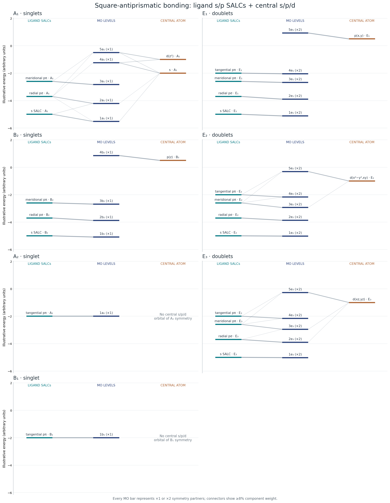

# Illustrative bonding diagram for a central s/p/d atom in a D₄d square antiprism

[Open the scalable SVG version](bonding_diagram.svg). This is the square-antiprismatic counterpart of the [tetrahedral bonding diagram](../tetrahedral_salcs/bonding_diagram.md). All seven energy panels, in both columns, use **exactly the same vertical scale**; numerical tick labels appear only on the left. Energies and interaction strengths are **invented for teaching**, not calculated for a particular element or ligand. No electrons are shown, so the diagram does not establish an occupation pattern or bond order.

Each horizontal MO bar denotes an **entire symmetry multiplet**. A₁, A₂, B₁, and B₂ levels are nondegenerate (×1); E₁, E₂, and E₃ levels are doubly degenerate (×2). The number before an MO label counts levels from low to high *within its own irrep*. For example, `3e₂ (×2)` is the third E₂ energy level and represents two spatial orbitals at that energy. The identical −2.0 energies of the A₂ and B₁ bars are an **accidental coincidence of this simplified model**, not a degeneracy required by D₄d symmetry.

## Which orbitals have matching symmetry?

The [square-antiprismatic SALC derivation](derivation.md) constructs 32 ligand s/p orbitals from eight sites. In the D₄d notation used there,

$$
\Gamma_{\mathrm{ligand}}=
3A_1\oplus A_2\oplus B_1\oplus3B_2
\oplus4E_1\oplus4E_2\oplus4E_3.
$$

The multiplicities give 3 + 1 + 1 + 3 + 2(4 + 4 + 4) = **32 spatial orbitals**. The four local ligand families are s, radial pσ, meridional pπ, and tangential pπ. The first three supply one A₁, one B₂, and one of each E irrep; tangential pπ instead supplies A₂, B₁, and one of each E irrep.

For the central atom, the s orbital is A₁. The pz orbital is B₂; (px, py) form E₁. The five d orbitals split as

$$
d_{z^2}:A_1,\qquad
(d_{x^2-y^2},d_{xy}):E_2,\qquad
(d_{xz},d_{yz}):E_3.
$$

The assignments follow directly from the 45° improper rotation S₈ and the xz mirror used in the [SALC derivation](derivation.md): z changes sign under S₈ but not under the mirror, identifying pz as B₂. The x/y pair rotates by 45°, giving S₈ character √2 and hence E₁. The quadratic pair (x²−y², xy) rotates by 90° in its two-dimensional function space, giving S₈ character 0 and hence E₂. Reflection across the xy plane reverses both xz and yz, so their S₈ matrix is minus a 45° rotation, with character −√2: E₃. The z² combination is unchanged and is A₁. These characters agree with the [D₄d character table](https://www.quanty.org/physics_chemistry/point_groups/d4d).

Thus the nine central s/p/d orbitals give

$$
\Gamma_{\mathrm{central}}=2A_1\oplus B_2\oplus E_1\oplus E_2\oplus E_3,
$$

and the combined 41-orbital space gives

$$
\Gamma_{\mathrm{MO}}=
5A_1\oplus A_2\oplus B_1\oplus4B_2
\oplus5E_1\oplus5E_2\oplus5E_3.
$$

The dimension check is 5 + 1 + 1 + 4 + 2(5 + 5 + 5) = **41 = 32 + 9**. Only orbitals of the **same irrep** may mix while D₄d symmetry is maintained. A₂ and B₁ have no central s/p/d partner, so their bars remain purely ligand-derived in this restricted basis. Additional central-orbital types or ligand–ligand interactions could change their energies and character in a larger model.

## The deliberately simple energy model

All energies are in arbitrary units. Before mixing, every SALC of a given ligand family receives the same illustrative energy: s at −5.0, radial pσ at −3.7, meridional pπ at −2.6, and tangential pπ at −2.0. Central s starts at −2.0, every central p at +0.5, and every central d at −1.0. Equal starting energies for the central p and d subsets avoid inventing a splitting of the isolated central atom; the final MO levels split differently because their allowed couplings differ.

The script diagonalizes a separate real symmetric Hamiltonian for each irrep. Its diagonal contains those starting energies. The only nonzero off-diagonal entries are between ligand SALCs and central AOs of the same irrep. In a consistent partner basis, the same block acts on *each* partner of an E irrep, so its final levels remain exactly doubly degenerate. Schematically, for irrep Γ of dimension dΓ, the full symmetry block has the form

$$
H_{\Gamma,\mathrm{full}}=H_{\Gamma,\mathrm{copies}}\otimes I_{d_\Gamma}.
$$

The toy coupling strengths are:

| Irrep | Ligand SALCs, in matrix order | Central AOs, in matrix order | Ligand-to-central coupling rows |
|:--|:--|:--|:--|
| A₁ | s, radial pσ, meridional pπ | s, d(z²) | (1.10, 0.25); (1.30, 0.40); (0.50, 0.65) |
| B₂ | s, radial pσ, meridional pπ | p(z) | 0.65; 0.90; 0.60 |
| E₁ | s, radial pσ, meridional pπ, tangential pπ | p(x,y) | 0.75; 0.95; 0.55; 0.40 |
| E₂ | s, radial pσ, meridional pπ, tangential pπ | d(x²−y²,xy) | 0.25; 0.60; 0.80; 0.70 |
| E₃ | s, radial pσ, meridional pπ, tangential pπ | d(xz,yz) | 0.25; 0.65; 0.85; 0.70 |
| A₂, B₁ | tangential pπ | none | none |

For example, the A₁ block is

$$
H_{A_1}=\begin{pmatrix}
-5.0&0&0&1.10&0.25\\
0&-3.7&0&1.30&0.40\\
0&0&-2.6&0.50&0.65\\
1.10&1.30&0.50&-2.0&0\\
0.25&0.40&0.65&0&-1.0
\end{pmatrix}.
$$

Diagonalization gives these illustrative MO energies, rounded to three decimals:

| Symmetry | Levels from low to high | Degeneracy of *each* level |
|:--|:--|--:|
| A₁ | −5.524, −4.211, −2.830, −1.240, −0.494 | 1 |
| A₂ | −2.000 | 1 |
| B₁ | −2.000 | 1 |
| B₂ | −5.087, −3.881, −2.686, +0.854 | 1 |
| E₁ | −5.117, −3.897, −2.675, −2.042, +0.930 | 2 |
| E₂ | −5.019, −3.867, −2.935, −2.168, −0.311 | 2 |
| E₃ | −5.019, −3.898, −2.954, −2.159, −0.270 | 2 |

Connectors show input-orbital contributions with at least **8% squared coefficient** in this model. Darker, thicker lines denote larger weights. The omission of a faint connector does not imply that its symmetry-allowed coupling vanishes. The A₂ and B₁ levels stay at their ligand starting energy because this basis contains no central s/p/d orbital of either symmetry. Splitting of an interacting set into lower and higher levels illustrates bonding and antibonding mixing, but this toy diagram does **not** predict a real compound’s ordering, occupancy, or bonding strength.

Regenerate the PNG and SVG from the project root with `python square_antiprism_salcs/generate_bonding_diagram.py` after installing the [figure dependencies](requirements.txt). Use `--check-only` to verify the 32 + 9 = 41 orbital count, symmetry-block dimensions, matrix symmetry, eigensystems, and connector endpoints without redrawing.
