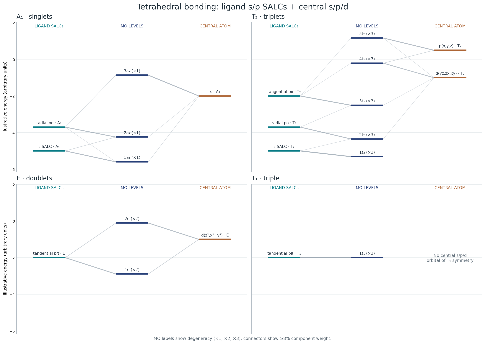

# Illustrative bonding diagram for a central s/p/d atom in a Td tetrahedron

[Open the scalable SVG version](bonding_diagram.svg). All four panels—including both columns—use **exactly the same vertical energy scale**; the numerical tick labels appear only on the left to avoid clutter. The energies and coupling strengths are **invented for teaching**, not fitted to a particular element or ligand. No electrons are drawn, so the figure does not specify an electron count, occupation pattern, or bond order. Every horizontal bar represents an **entire irrep multiplet**, not just one member: A₁ is nondegenerate (×1), E has two degenerate partners (×2), and T₁/T₂ each have three (×3). The ×1/×2/×3 annotations on the MO labels make these multiplicities explicit. The prefixes 1, 2, … number levels from low to high *within each symmetry sector*; lowercase a/e/t in MO labels name the same irreps as uppercase A/E/T.

## Which levels are allowed to meet?

The [tetrahedral ligand analysis](derivation.md) gives four ligand s orbitals and twelve ligand p orbitals, decomposed into

$$
\Gamma_{\mathrm{ligand}}=2A_1\oplus E\oplus T_1\oplus3T_2
\qquad(16\text{ spatial orbitals}).
$$

The one central atom supplies one s orbital, three p orbitals, and five d orbitals. Under Td, s is A₁ and the Cartesian p triplet is T₂. The d functions split by symmetry into the E pair (dz², dx²−y²) and the T₂ triplet (dyz, dzx, dxy). A way to see the split is to represent the five d functions by traceless quadratic forms. Signed coordinate permutations keep the two diagonal combinations (2z²−x²−y², x²−y²) together and separately keep the three off-diagonal forms (yz, zx, xy) together. Their characters identify E and T₂, consistent with the [Td character table](https://www.quanty.org/physics_chemistry/point_groups/td). We list the T₂ d partners in the order (yz, zx, xy) so they align with the x, y, z partners of the other T₂ sets in the toy coupling model. Hence

$$
\Gamma_{\mathrm{central}}=A_1\oplus E\oplus2T_2
\qquad(9\text{ spatial orbitals}),
$$

and the combined 25-orbital space has

$$
\Gamma_{\mathrm{MO}}=3A_1\oplus2E\oplus T_1\oplus5T_2.
$$

Only functions of the **same symmetry** may mix. That is why the figure has separate A₁, E, T₁, and T₂ sectors, with three, two, one, and five MO levels respectively. Each T₂ level is *triply* degenerate, so the dimension count is 3(1) + 2(2) + 1(3) + 5(3) = **25**. The ligand T₁ triplet has no central s/p/d partner and stays nonbonding **within this restricted basis**. An enlarged basis containing central orbitals of T₁ symmetry could change that conclusion.

## The deliberately simple energy model

All numbers below are in arbitrary energy units. Repeated ligand-family energies are set equal before mixing: ligand s SALCs start at −5.0, radial ligand pσ SALCs at −3.7, and tangential ligand pπ SALCs at −2.0, regardless of irrep. Central s starts at −2.0, central p at +0.5, and both central d subsets start together at −1.0. These choices avoid claiming a pre-existing d(E)/d(T₂) splitting for the isolated atom.

Within each symmetry sector, the script diagonalizes a real symmetric interaction matrix. Its diagonal is the starting energies just listed. The **only nonzero off-diagonal entries** join ligand and central functions of the same irrep. The coupling strengths are:

| Sector | Ligand SALCs, in order | Central orbitals, in order | Ligand-to-central couplings |
|:--|:--|:--|:--|
| A₁ | s, radial pσ | central s | 1.2, 1.5 |
| E | tangential pπ | central d(E) | 1.3 |
| T₁ | tangential pπ | none | none |
| T₂ | s, radial pσ, tangential pπ | central d(T₂), central p | matrix below |

The T₂ coupling matrix has ligand rows and central-atom columns in the order shown:

$$
V_{T_2}=\begin{pmatrix}
0.4&1.0\\
1.3&0.8\\
1.2&0.7
\end{pmatrix}.
$$

For example, in the A₁ sector the matrix is

$$
H_{A_1}=\begin{pmatrix}
-5.0&0&1.2\\
0&-3.7&1.5\\
1.2&1.5&-2.0
\end{pmatrix}.
$$

The same coupling numbers apply to every partner of a multidimensional irrep, preserving Td symmetry. No direct ligand–ligand or central–central mixing has been added to this toy matrix. The diagonalization produces the following illustrative MO energies (rounded):

| Symmetry | Levels from low to high |
|:--|:--|
| A₁ | −5.597, −4.243, −0.860 |
| E | −2.893, −0.107 |
| T₁ | −2.000 |
| T₂ | −5.312, −4.345, −2.505, −0.206, +1.169 |

The diagonal connectors show input-orbital contributions whose **squared coefficient is at least 8%** in this model. Darker, thicker connectors mean greater weight; omitted faint contributions are still symmetry-allowed. The T₁ line remains at exactly its ligand starting energy because it has no matching central s/p/d level. The separation of each interacting set into lower and higher MOs illustrates bonding and antibonding mixing, but this model does **not** predict a real compound's ordering or occupancy.

Regenerate the PNG and SVG from the project root with `python tetrahedral_salcs/generate_bonding_diagram.py` after installing the [figure dependencies](requirements.txt). Run the script with `--check-only` to verify the 16 + 9 = 25 orbital count, block dimensions, Hermiticity, and eigensystems without redrawing.
